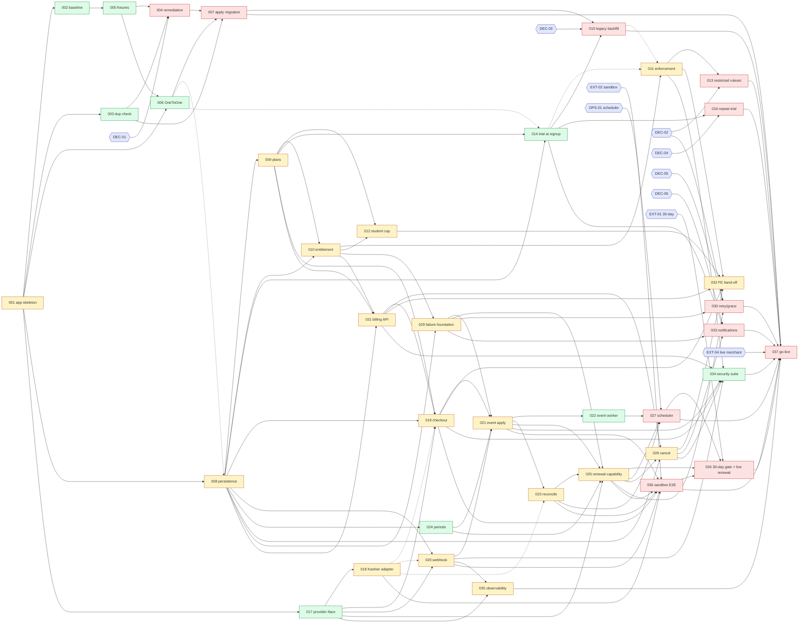

# Dependency Graph — BILL-PLAN-01

> **Direction:** `prerequisite → dependent`. **Types:** BLOCKING · DECISION · CONTRACT · DATA · ENVIRONMENT ·
> EXTERNAL · OPERATIONAL · VERIFICATION. "Blocks execution?" = **Yes** if the dependent can't start or finish
> before the prerequisite resolves; **No** if it only gates later verification or launch (noted).
> The graph was derived from the Work Unit specs **before** sequencing. It was checked mechanically: 99
> WU→WU edges, topological sort succeeds over all 42 units, **no cycle**. Check script logic: Kahn's
> algorithm; run in the session scratchpad; not part of the repo.

## 1. WU → WU edges (99)

| # | Prereq → Dependent | Type | Blocks execution? | Why | Resolution criterion |
|---|---|---|---|---|---|
| 1 | 001 → 002 | BLOCKING | Yes | Suite can't load apps while `billing` is phantom | AC-BILL-001-1 |
| 2 | 001 → 003 | BLOCKING | Yes | Management command needs a booting project | AC-BILL-001-1 |
| 3 | 001 → 006 | BLOCKING | Yes | Tests must run | AC-BILL-001-1 |
| 4 | 001 → 008 | BLOCKING | Yes | App package must exist | AC-BILL-001-1/2 |
| 5 | 001 → 017 | BLOCKING | Yes | App package must exist | AC-BILL-001-1 |
| 6 | 002 → 005 | VERIFICATION | Yes | "Before" baseline needed to judge fixture changes | AC-BILL-002-1 |
| 7 | 003 → 004 | DATA | Yes | Remediation needs per-DB facts | AC-BILL-003-6 |
| 8 | 005 → 004 | BLOCKING | Conditional (option "reseed") | Reseeding must not recreate duplicates | AC-BILL-005-4 |
| 9 | 005 → 006 | BLOCKING | Yes | Existing fixtures would violate the constraint | AC-BILL-005-1 |
| 10 | 006 → 007 | BLOCKING | Yes | Migration must exist and pass | AC-BILL-006-1..7 |
| 11 | 003 → 007 | DATA | Yes | Zero-duplicate evidence per DB | AC-BILL-003-6 = 0 |
| 12 | 004 → 007 | DATA | Yes, if duplicates exist | Remediated DB | AC-BILL-004-2 |
| 13 | 006 → 008 | DATA | **No** (authoring); Yes for launch | Subscription-per-Environment = per-account only once INV-9 is DB-enforced | AC-BILL-006-2 |
| 14 | 008 → 009 | BLOCKING | Yes | Plan table | AC-BILL-008-8 |
| 15 | 008 → 010 | BLOCKING | Yes | Reads subscription state | AC-BILL-008-* |
| 16 | 009 → 010 | DATA | Yes | Capability keys, caps | AC-BILL-009-1/2 |
| 17 | 010 → 011 | CONTRACT | Yes | Consumes decision | AC-BILL-010-* |
| 18 | 014 → 011 | DATA | **No** (code); Yes for meaningful prod behaviour | New teachers need trial state | AC-BILL-014-1 |
| 19 | 015 → 011 | DATA | **No** (code); Yes for launch | Legacy teachers need state | AC-BILL-015-1 |
| 20 | 010 → 012 | CONTRACT | Yes | Cap source | AC-BILL-010-5 |
| 21 | 009 → 012 | DATA | Yes | Cap values | AC-BILL-009-1 |
| 22 | 011 → 013 | BLOCKING | Yes | Reuses enforcement mechanism | AC-BILL-011-* |
| 23 | 008 → 014 | BLOCKING | Yes | Subscription persistence | AC-BILL-008-1 |
| 24 | 009 → 014 | DATA | Yes | Trial = Plan 3 set | AC-BILL-009-2 |
| 25 | 006 → 014 | DATA | **No** | As #13 | AC-BILL-006-2 |
| 26 | 014 → 015 | BLOCKING | Yes | Reuses `start_trial`/sibling | AC-BILL-014-* |
| 27 | 007 → 015 | DATA | Yes (per DB) | One env per teacher first | AC-BILL-007-1/2 |
| 28 | 014 → 016 | BLOCKING | Yes | Hook point | AC-BILL-014-* |
| 29 | 017 → 018 | CONTRACT | Yes | Implements interface | AC-BILL-017-* |
| 30 | 008 → 019 | BLOCKING | Yes | PaymentAttempt | AC-BILL-008-2/4 |
| 31 | 009 → 019 | DATA | Yes | Price | AC-BILL-009-1 |
| 32 | 017 → 019 | CONTRACT | Yes | Provider interface | AC-BILL-017-1 |
| 33 | 031 → 019 | CONTRACT | Yes | URL namespace | AC-BILL-031-1 |
| 34 | 018 → 019 | CONTRACT | **No** (fake suffices); Yes for sandbox | Real Kashier | AC-BILL-018-6 |
| 35 | 008 → 020 | BLOCKING | Yes | Provider-event record + dedup constraint | AC-BILL-008-3 |
| 36 | 017 → 020 | CONTRACT | Yes | `verify_and_parse_webhook` | AC-BILL-017-2 |
| 37 | 018 → 020 | CONTRACT | **No** (fixtures); Yes for sandbox | Real scheme | AC-BILL-018-1/6 |
| 38 | 020 → 021 | BLOCKING | Yes | Received events to apply | AC-BILL-020-1 |
| 39 | 019 → 021 | DATA | Yes | Attempts to correlate | AC-BILL-019-1 |
| 40 | 024 → 021 | CONTRACT | Yes | Period creation on activation | AC-BILL-024-1 |
| 41 | 029 → 021 | CONTRACT | Yes | Failure recording | AC-BILL-029-1/2 |
| 42 | 021 → 022 | BLOCKING | Yes | Application logic | AC-BILL-021-* |
| 43 | 021 → 023 | BLOCKING | Yes | Shared transitions | AC-BILL-021-* |
| 44 | 018 → 023 | CONTRACT | **No** (fake lookup); Yes for sandbox | Lookup API | AC-BILL-018-6 |
| 45 | 008 → 024 | BLOCKING | Yes | BillingPeriod model | AC-BILL-008-5 |
| 46 | 024 → 025 | BLOCKING | Yes | Due computation | AC-BILL-024-* |
| 47 | 017 → 025 | CONTRACT | Yes | `charge_saved_agreement` | AC-BILL-017-1 |
| 48 | 021 → 025 | CONTRACT | Yes | Shared transitions | AC-BILL-021-* |
| 49 | 023 → 025 | CONTRACT | Yes | Ambiguous-outcome path | AC-BILL-023-* |
| 50 | 029 → 025 | CONTRACT | Yes | Failure recording | AC-BILL-029-* |
| 51 | 025 → 026 | BLOCKING | Yes | Capability to activate | AC-BILL-025-* |
| 52 | 036 → 026 | VERIFICATION | Yes | Sandbox evidence | AC-BILL-036-* |
| 53 | 027 → 026 | OPERATIONAL | Yes | Scheduler | AC-BILL-027-* |
| 54 | 022 → 027 | BLOCKING | Yes | Command to schedule | AC-BILL-022-* |
| 55 | 023 → 027 | BLOCKING | Yes | Command to schedule | AC-BILL-023-* |
| 56 | 025 → 027 | BLOCKING | Yes | Command to schedule | AC-BILL-025-* |
| 57 | 008 → 028 | BLOCKING | Yes | Flag field | AC-BILL-008-* |
| 58 | 025 → 028 | CONTRACT | Yes | Race partner / lock order | AC-BILL-025-2/5 |
| 59 | 031 → 028 | CONTRACT | Yes | Namespace | AC-BILL-031-1 |
| 60 | 008 → 029 | BLOCKING | Yes | Fields | AC-BILL-008-* |
| 61 | 010 → 029 | CONTRACT | Yes | Entitlement reading of failed state | AC-BILL-010-4 |
| 62 | 029 → 030 | BLOCKING | Yes | Recording | AC-BILL-029-* |
| 63 | 025 → 030 | BLOCKING | Yes | Mechanics | AC-BILL-025-* |
| 64 | 008 → 031 | BLOCKING | Yes | Data | AC-BILL-008-* |
| 65 | 009 → 031 | DATA | Yes | Plans list | AC-BILL-009-1 |
| 66 | 010 → 031 | CONTRACT | Yes | Entitlement summary | AC-BILL-010-* |
| 67 | 011 → 032 | CONTRACT | Yes | Error codes to describe | AC-BILL-011-1 |
| 68 | 012 → 032 | CONTRACT | Yes | Cap error | AC-BILL-012-1 |
| 69 | 019 → 032 | CONTRACT | Yes | Checkout contract | AC-BILL-019-* |
| 70 | 028 → 032 | CONTRACT | Yes | Cancel contract | AC-BILL-028-* |
| 71 | 031 → 032 | CONTRACT | Yes | Read contract | AC-BILL-031-* |
| 72 | 014 → 033 | DATA | Yes | Trial events | AC-BILL-014-1 |
| 73 | 029 → 033 | DATA | Yes | Failure events | AC-BILL-029-1 |
| 74 | 028 → 033 | DATA | Yes | Cancellation events | AC-BILL-028-1 |
| 75 | 011 → 034 | VERIFICATION | Yes | Surface under test | AC-BILL-011-* |
| 76 | 019 → 034 | VERIFICATION | Yes | Surface | AC-BILL-019-* |
| 77 | 020 → 034 | VERIFICATION | Yes | Surface | AC-BILL-020-* |
| 78 | 021 → 034 | VERIFICATION | Yes | Surface | AC-BILL-021-* |
| 79 | 028 → 034 | VERIFICATION | Yes | Surface | AC-BILL-028-* |
| 80 | 031 → 034 | VERIFICATION | Yes | Surface | AC-BILL-031-* |
| 81 | 017 → 035 | CONTRACT | Yes | Secret catalogue | AC-BILL-017-* |
| 82 | 020 → 035 | CONTRACT | Yes | Logging points | AC-BILL-020-* |
| 83 | 018 → 036 | BLOCKING | Yes | To verify | AC-BILL-018-1..5 |
| 84 | 019 → 036 | BLOCKING | Yes | To verify | AC-BILL-019-* |
| 85 | 020 → 036 | BLOCKING | Yes | To verify | AC-BILL-020-* |
| 86 | 021 → 036 | BLOCKING | Yes | To verify | AC-BILL-021-* |
| 87 | 023 → 036 | BLOCKING | Yes | To verify | AC-BILL-023-* |
| 88 | 025 → 036 | BLOCKING | Yes | To verify | AC-BILL-025-* |
| 89 | 007 → 037 | BLOCKING | Yes | Prod cardinality | AC-BILL-007-2 |
| 90 | 013 → 037 | BLOCKING | Yes | Restricted ruleset | AC-BILL-013-* |
| 91 | 015 → 037 | BLOCKING | Yes | Legacy accounts | AC-BILL-015-1 |
| 92 | 016 → 037 | DECISION | Yes | Repeat-trial decision must exist | AC-BILL-016-1 |
| 93 | 026 → 037 | BLOCKING | Yes | 30-day gate | AC-BILL-026-1..3 |
| 94 | 027 → 037 | OPERATIONAL | Yes | Scheduler | AC-BILL-027-* |
| 95 | 030 → 037 | BLOCKING | Yes | Retry/grace | AC-BILL-030-* |
| 96 | 033 → 037 | BLOCKING | Yes | Teacher notification expected | AC-BILL-033-1 |
| 97 | 036 → 037 | VERIFICATION | Yes | Sandbox | AC-BILL-036-* |
| 98 | 034 → 037 | VERIFICATION | Yes | Security suite | AC-BILL-034-1 |
| 99 | 035 → 037 | VERIFICATION | Yes | Observability | AC-BILL-035-* |

Seven edges are non-blocking for execution (#13, #18, #19, #25, #34, #37, #44). The critical path below
uses only the 92 blocking edges.

## 2. Gate nodes → WU (decision / external / operational; gates have in-degree 0)

| Gate | Type | Dependent WUs | Blocks execution? | Resolution criterion |
|---|---|---|---|---|
| BILL-DEC-01 duplicate-owner remediation policy | DECISION (DATA-typed gate) | 004 (→ 007) | Yes, only if duplicates found | Approved per-DB policy record |
| BILL-DEC-02 restricted-access ruleset | DECISION | 013, 030; partial 010/032 (non-blocking) | Yes for 013/030 | Recorded in commercial-model by product/System |
| BILL-DEC-03 legacy-account commercial state | DECISION | 015 | Yes | Recorded policy |
| BILL-DEC-04 repeat-trial policy | DECISION | 016 | Yes | Recorded policy (may be "none") |
| BILL-DEC-05 retry count/schedule, grace duration | DECISION | 030; non-blocking for 010/025/029 | Yes for 030 | Numbers recorded in commercial-model |
| BILL-DEC-06 billing notification channel/catalog | DECISION (System-level) | 033 | Yes | System docs updated by owner |
| BILL-DEC-07 plan-feature mapping; student-count definition | DECISION | 009, 011, 012 (non-blocking) | No | Recorded mapping |
| BILL-DEC-08 phantom `billing` registration intent | DECISION | 001 (non-blocking for execution; blocking for merge if a competing implementation exists) | No | Author confirmation |
| BILL-EXT-01 Kashier exact 30-elapsed-day recurring compatibility | EXTERNAL | 026 (and live agreement creation in 018) | **Yes** | Written Kashier confirmation plus sandbox evidence |
| BILL-EXT-02 sandbox merchant credentials | EXTERNAL | 036; verification of 018-021/023/025 | Yes for 036 | Test-mode account plus keys provisioned |
| BILL-EXT-03 signature key, payload/token fields, status-lookup API, token-deletion obligations | EXTERNAL | 018, 019, 020, 021, 023, 028 (non-blocking for build; blocking for VERIFIED) | No (build) | Answers recorded via 036 |
| BILL-EXT-04 live merchant activation | EXTERNAL | 026, 037 | Yes | Kashier live account active |
| BILL-EXT-05 recurring-agreement consent requirements | EXTERNAL | 019 (live) | No (build) | Kashier answer recorded |
| BILL-OPS-01 production scheduler owner/mechanism | OPERATIONAL | 027 | Yes | Operations decision |
| BILL-OPS-02 PostgreSQL test DB | ENVIRONMENT | 001-verification, 002 and all tests | Yes | DB reachable |
| BILL-OPS-03 inventory of shared DBs | OPERATIONAL | 003 (AC-6), 007 | Yes for those ACs | List agreed |
| BILL-OPS-04 public HTTPS webhook URL per env/mode | OPERATIONAL | 020 (sandbox), 036, 037 | Yes for 036/037 | URL provisioned |

## 3. Mermaid graph (blocking edges; dashed = non-blocking; hexagons = gates)

OUT OF SCOPE units BILL-WU-038..042 have no edges. They are isolated by design, each with a DECISION
dependency on a product policy for any future re-scoping.

## 4. Cycle check

- **Result:** no cycle. Kahn's algorithm consumed all 42 nodes over all 99 edges.
- **Apparent cycles found during design and resolved:**
  1. *Event application ↔ failure recording.* Webhook FAILURE handling (021) needed failure recording, and
     a late-placed "failed payment" unit would have depended on 021 and 025. **Resolved** by making
     BILL-WU-029 a foundation (depends only on 008/010) consumed by 021 and 025.
  2. *Renewal ↔ cancellation.* 025 must honour the cancel flag, and 028's race tests need 025. **Resolved:**
     the flag *field* lives in 008. 025 reads it (008 → 025 via 024). 028 depends on 025 (CONTRACT, lock
     order). There is no edge 028 → 025.
  3. *Checkout ↔ API namespace.* **Resolved:** 031 owns the namespace and read endpoints; 019 and 028 mount
     action endpoints into it (031 → 019, 031 → 028).
  4. *30-day gate ↔ sandbox.* **Resolved:** 036 verifies capability (025 → 036); 026 consumes 036's evidence
     (036 → 026). Sandbox can't prove the 30-day interval, so 026 also needs BILL-EXT-01 independently.

## 5. Critical path and execution order

**Critical path (execution-blocking edges only; 12 units, 11 edges):**
`BILL-WU-001 → 008 → 009 → 010 → 031 → 019 → 021 → 023 → 025 → 028 → 033 → 037`

Equal-length parallel branch from 025: `025 → 036 → 026 → 037` (carrying BILL-EXT-02, BILL-EXT-01,
BILL-EXT-04). Gates sitting on or beside the critical path: BILL-DEC-06 (033), BILL-EXT-01 (026),
BILL-EXT-02 (036), BILL-EXT-04 (037), plus the decision-gated 013/015/016/030 feeding 037. In practice the
**gates**, not the engineering chain, determine the launch date.

**Execution order (waves = topological levels over blocking edges; derived after the graph):**

| Wave | Units | Notes |
|---|---|---|
| W0 | 001 | Root; resolves BILL-RISK-01 |
| W1 | 002, 003, 008, 017 | 008/017 don't wait for cardinality; see deviation note |
| W2 | 005, 009, 018, 020, 024 | |
| W3 | 006, 010, 014, 035 · (004 if duplicates and BILL-DEC-01) | |
| W4 | 011, 012, 029, 031 · (007 per DB, after 003 AC-6) · (016 when BILL-DEC-04) | |
| W5 | 019 · (013 when BILL-DEC-02) · (015 when BILL-DEC-03) | |
| W6 | 021 | |
| W7 | 022, 023 | |
| W8 | 025 | |
| W9 | 028, 027 (when BILL-OPS-01), 036 (when BILL-EXT-02), 030 (when BILL-DEC-05) | |
| W10 | 032, 034, 026 (when BILL-EXT-01), 033 (when BILL-DEC-06) | |
| W11 | 037 (when BILL-EXT-04 and all gates) | Launch |

**Deviation from the illustrative order (candidate workstreams A→K):** (1) Baseline repair (001/002) is
inserted before A because the suite probably can't run (BILL-RISK-01). (2) Billing persistence (008) and the
provider interface (017) start in parallel with cardinality instead of after it. Only *applying* the
migration (007) is data-gated, and 008 depends on cardinality only for launch (edge #13). (3) The failed-payment
foundation (029) moves ahead of inbound events (F) and renewal (G) to break the apparent cycle in §4.1.
(4) The billing API namespace (031, from I) moves ahead of checkout (E2) because checkout mounts into it.
(5) Production renewal activation (026) runs after sandbox verification (036, from J) rather than inside G.
